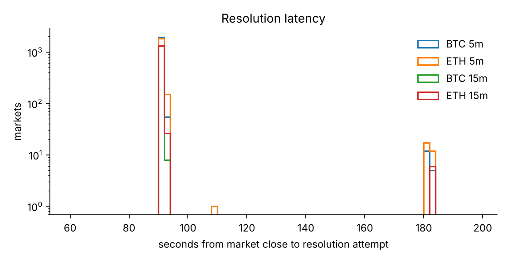
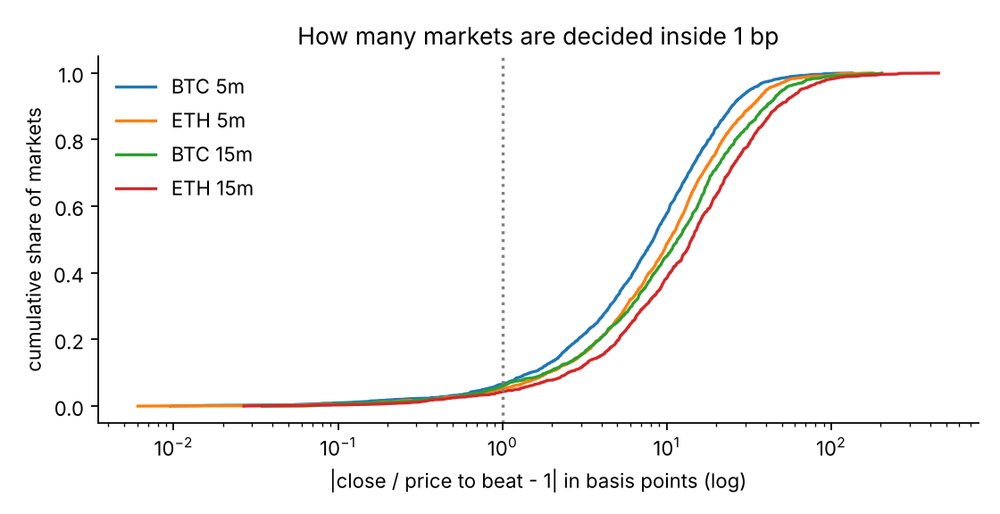
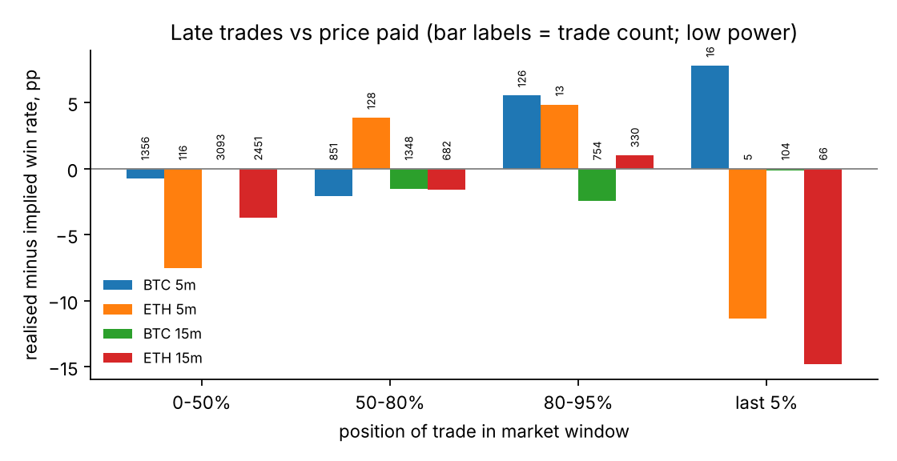

# Limitless recurring crypto markets: how they resolve, and what the trade data can and cannot show

Marco Amendola, November 2026

## Summary

I pulled every settled BTC and ETH up/down market on Limitless (Base) at 5 minute cadence over 7 days and at 15 minute cadence over 14 days, from the public API: 6,719 markets with all their finalized trades.

1. **Resolution path.** 100% of markets are flagged as mirrored from Polymarket. Inside the `chainlinkTwapResolution` metadata object, the resolution source is `polymarket-settlement` and the stored Polymarket payout matches the Limitless outcome on every market. The price is a Chainlink TWAP and the outcome is taken from Polymarket's settlement, which matches the docs' "external venue parity" category. The docs' section on 5 and 15 minute markets mentions the Chainlink TWAP but not the parity step.
2. **Timing.** Median resolution attempt 91.1 seconds after close. 58 markets (0.9%) resolved on what looks like a second attempt at about 180 seconds. That pattern fits a scheduled check on an external settlement with one retry. It is the most useful operational signal in the dataset.
3. **Record consistency.** Zero disagreements between the winning outcome, the "close >= price to beat" rule, the stored outcome label and the stored Polymarket payout. Each market's opening price equals the previous market's close in every adjacent pair. These checks show that Limitless records agree with each other. They do not verify the records against Chainlink or Polymarket.
4. **Near ties.** Between 4.4% and 6.6% of markets close within 1 basis point of the price to beat. On these markets a small difference in feed, window or timestamp could flip the outcome, which is where the choice of settlement source matters most.
5. **Late flow.** No detectable late edge, in a test with little power: -0.2 pp on BTC 15m (n=104), -14.8 pp on ETH 15m (n=66). Samples are small and clustered, so this does not rule an edge out.
6. **Activity.** Thin and concentrated. 90.9% of ETH 5 minute markets had no trades. The top 5 accounts carry 64.7% to 69.2% of traded USDC in every set (one side of each fill, see limitations).

## Data and method

- Source: `api.limitless.exchange`, endpoints `/markets/{slug}` and `/markets/{slug}/events` (public, finalized mined CLOB trades). Slugs follow `{asset}-up-or-down-{5|15}-min-{start_unix}` and were enumerated backwards from the last closed slot. One ETH 5 minute market returned 404.
- Windows end 2026-11-17 around 20:00 UTC. Only these windows were observed, so nothing here says whether the resolution path changed over time.
- Window 1 (BTC) was exploratory. Window 2 (ETH) was pulled after predictions were written down (see `predictions.md`, `research_log.md`).
- Trade value is matched shares times trade price, in USDC. For every market the sum of matched shares in the trade list equals the market's reported volume, so the trade lists are complete.
- "Implied win rate" of a trade is the price paid for the side the trader ended long (buy at p, or sell the other side at p, which is a long at 1-p).

## Results

| | BTC 5m | ETH 5m | BTC 15m | ETH 15m |
|---|---|---|---|---|
| Markets analysed | 2016 | 2015 | 1344 | 1344 |
| Source "polymarket-settlement" | 2016 | 2015 | 1344 | 1344 |
| Rule disagreements | 0 | 0 | 0 | 0 |
| Stored Polymarket payout disagreements | 0 | 0 | 0 | 0 |
| Open equals previous close | 2015 | 2013 | 1343 | 1343 |
| Median resolution lag, s | 90.9 | 91.1 | 91.1 | 91.3 |
| Max resolution lag, s | 183.3 | 183.5 | 182.8 | 183.0 |
| Second attempt (lag over 150 s) | 17 | 29 | 6 | 6 |
| Closed within 1 bp of price to beat | 133 (6.6%) | 108 (5.4%) | 81 (6.0%) | 59 (4.4%) |
| Markets with zero trades | 54.3% | 90.9% | 10.0% | 30.2% |
| USDC traded | 7,497 | 692 | 26,964 | 7,111 |
| Trading accounts | 76 | 26 | 120 | 72 |
| Top 5 accounts' share of USDC | 69.2% | 64.7% | 67.0% | 67.9% |
| Taker delay | 250 ms | 250 ms | 500 ms | 500 ms |
| Last 5% trades, n | 16 | 5 | 104 | 66 |
| Last 5%, realised minus implied win, pp | +7.8 | -11.4 | -0.2 | -14.8 |

"Open equals previous close" counts adjacent market pairs (2015, 2013, 1343, 1343 pairs). Every pair matches.

## Documented vs observed

| Topic | Documentation | Observed |
|---|---|---|
| Resolution, 5 and 15 minute crypto | Chainlink TWAP, Up if close >= price to beat; mirrored markets resolve "within minutes of the source venue settling" (external venue parity) | Flagged as mirrored from Polymarket; source `polymarket-settlement` inside `chainlinkTwapResolution`; first attempt about 91 s after close, 0.9% retried at about 180 s |
| Opening price | Price to beat at market start | Equals previous market's close in every adjacent pair; Limitless's own `polymarketOpenCheck` flag is true on 100% of markets |
| Latency speed bump | Not found in the pages read | `takerDelayMs` 250 on 5 minute and 500 on 15 minute markets |
| Audit coverage | Upstream Polymarket code only; Limitless changes not covered | Not testable from trade data |

## Limitations and production path

- **Every resolution field comes from the same Limitless API record.** Production path: re-read the Chainlink Data Streams reports and Polymarket's on-chain payouts for at least the near-tie markets, and compare.
- **Resolution timing is the metadata "attempted at" field, not on-chain finality.** Production path: read the resolution transactions and the CTF `ConditionResolution` events on Base.
- **Only recurring BTC and ETH crypto markets.** Manually resolved, sports and creator-resolved custom markets carry the larger integrity risk and are not covered.
- **Account level analysis uses the one profile the API attaches to each trade.** Wash trading between accounts cannot be measured without both maker and taker. Production path: on-chain `OrderFilled` events across all three venue versions.
- **Late-flow test has little power.** Trades cluster by market and by account (one account made 47% of late ETH 15 minute trades), and the reported z overstates significance. Even early buckets with thousands of trades move by several pp, so effects of that size cannot be separated from noise. With a TWAP settlement the last seconds of the window also sit inside the averaging period, which weakens the test. Production path: market-level bootstrap on a longer window.
- **Anonymisation is limited.** Account ids replace addresses and tx hashes are removed, but timestamps, sizes and prices are kept, so trades can be matched to public on-chain fills.

Code, raw data and the research log, including the prediction that failed, are in this repository.
